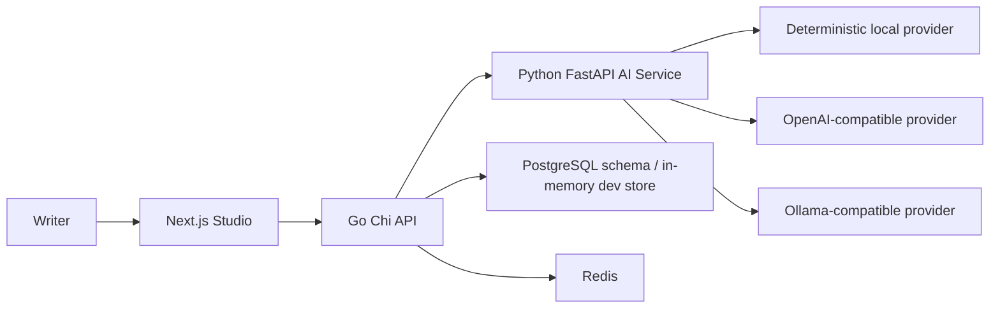

# OpenRewrite Studio

OpenRewrite Studio is a privacy-first writing transformation studio for rewriting text with clarity, tone control, transparent diffs, and meaning-preservation checks. It is positioned as an ethical writing assistant, not an AI-detector bypass tool.

## Architecture



Bounded contexts:

- `Rewrite`: modes, tone, strength, sentence diffs, meaning lock, warnings.
- `Workspace`: users, workspaces, members, presets, API keys.
- `Operations`: health checks, audit logs, usage events, provider configuration.

## Quick Start

```bash
npm install
python3 -m venv ai-service/.venv
ai-service/.venv/bin/pip install -r ai-service/requirements.txt
(cd backend && go mod download)
npm run dev
```

Local URLs:

- Frontend: http://localhost:3000
- API: http://localhost:8080
- AI service: http://localhost:8000

Docker:

```bash
cp .env.example .env
docker compose up --build
```

## Tests

```bash
npm run typecheck
npm run test:frontend
npm run test:backend
npm run test:ai
```

## Key Features

- Side-by-side rewrite studio with sentence-level diff.
- Rewrite modes: standard, fluency, professional, simple, shorten, expand, natural, academic.
- Tone controls and rewrite strength slider.
- Humanize mode with naturalness scoring, style notes, and click-to-replace word alternatives.
- Meaning Lock with score, entity/number/citation preservation warnings.
- History, presets, API keys, and admin usage surfaces.
- Ollama-compatible rewriting by default, with local deterministic and OpenAI-compatible adapters available.
- Docker Compose for self-hosting with PostgreSQL, Redis, API, AI service, frontend, and nginx.
- Tauri desktop shell scaffold for a native install path while keeping the web app as the source of truth.

## License Decision

The project is prepared as `AGPL-3.0-only`. See [DECISIONS.md](DECISIONS.md) for rationale and migration options.
